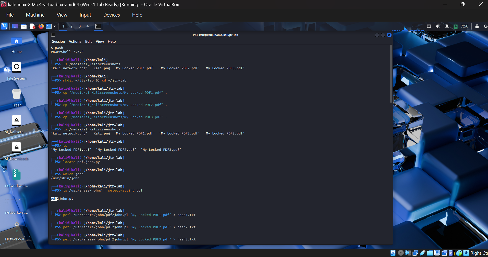
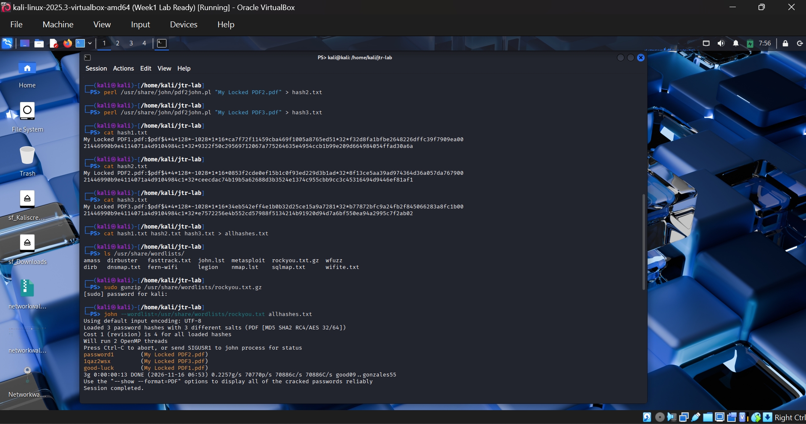
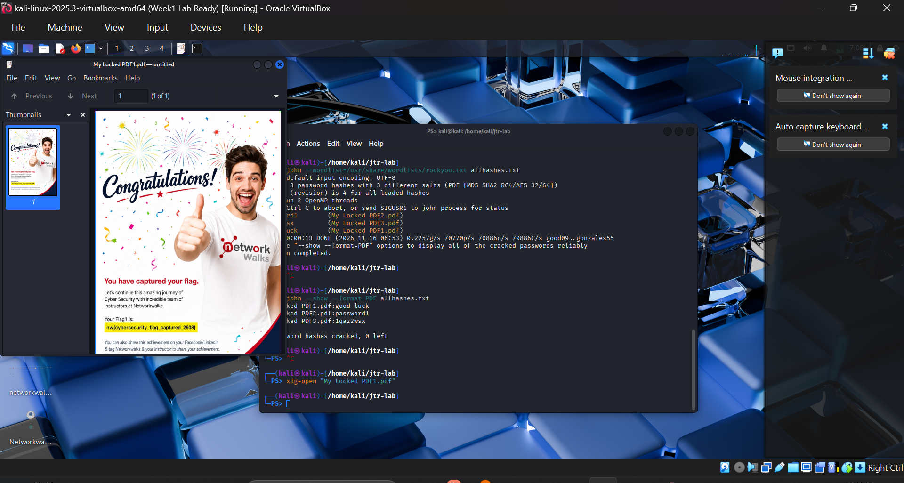
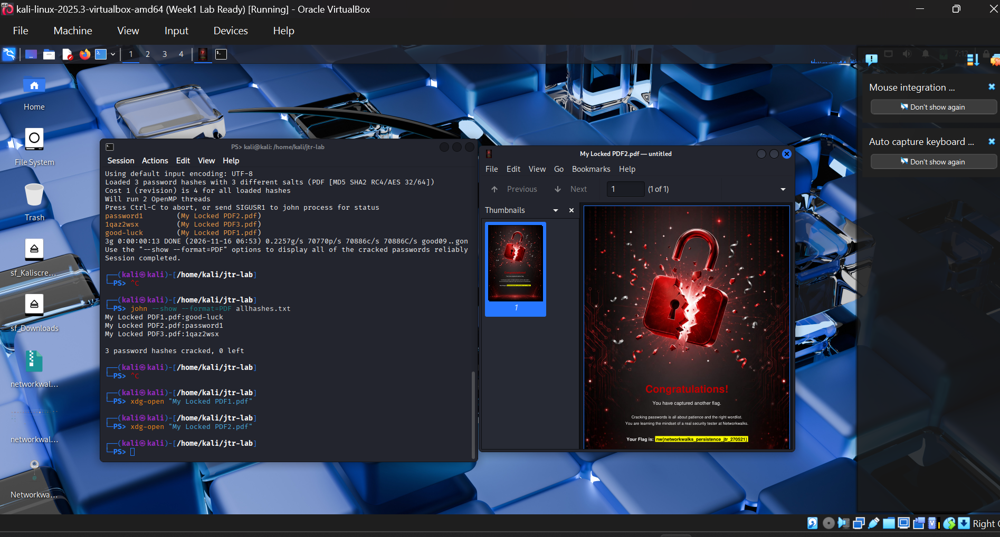
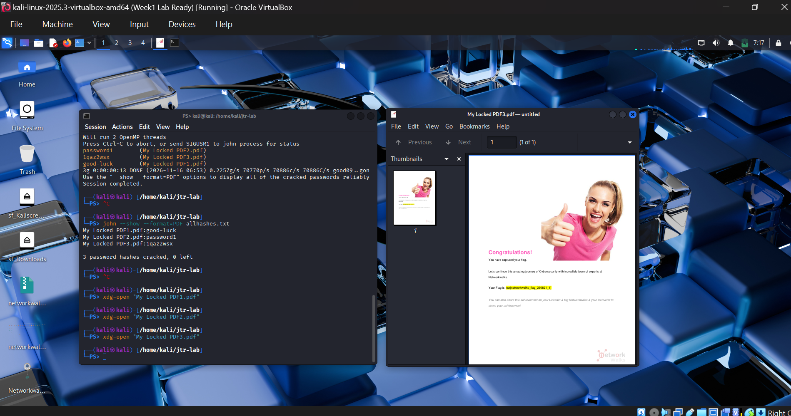
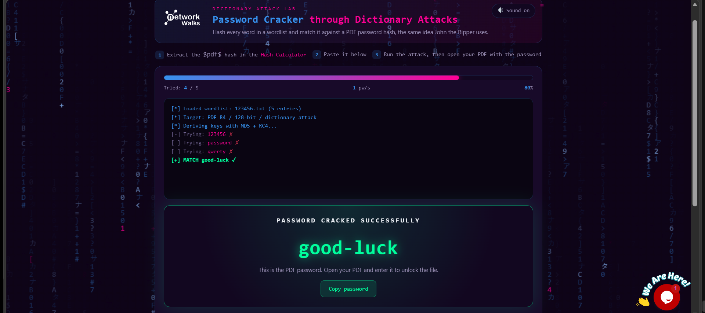

# 🔐 NETWORKWALKS-WEEK3-PASSWORD-CRACKING

**Cybersecurity Internship — Networkwalks Academy**

This repository documents Week 3 of my Networkwalks Cybersecurity Internship, focusing on password recovery and hash analysis using John the Ripper on Kali Linux and Networkwalks' browser-based password-cracking tools.

---

## 📌 Overview

Week 3 covered two practical modules:

| Module | Focus |
|---|---|
| **W3-PM1** | Password Cracking with John the Ripper (JtR) on Kali Linux |
| **W3-PM2** | Password Cracking with Networkwalks Hash Calculator and Password Cracker |

**Skills Practiced:** PDF hash extraction, dictionary attacks, wordlist usage, password recovery, hash analysis, and password security.

---

## 🛠️ Tools & Environment

- **Operating System:** Kali Linux
- **Virtualization:** Oracle VirtualBox
- **Offline Cracking Tool:** John the Ripper
- **Hash Extraction Tool:** pdf2john.pl
- **Wordlist:** RockYou (rockyou.txt)
- **Online Tools:** Networkwalks Hash Calculator and Password Cracker

**Target Files:**
- `My Locked PDF1.pdf`
- `My Locked PDF2.pdf`
- `My Locked PDF3.pdf`

---

## 🧩 W3-PM1: Password Cracking with John the Ripper

### Objective

Extract password hashes from three protected PDF documents and recover their passwords using John the Ripper and a dictionary attack on Kali Linux.

### Workflow

**1. Extract Password Hashes**

Used pdf2john.pl to extract hashes from the three PDF documents.

```bash
perl /usr/share/john/pdf2john.pl "My Locked PDF1.pdf" > hash1.txt
perl /usr/share/john/pdf2john.pl "My Locked PDF2.pdf" > hash2.txt
perl /usr/share/john/pdf2john.pl "My Locked PDF3.pdf" > hash3.txt
```

Combined the extracted hashes:

```bash
cat hash1.txt hash2.txt hash3.txt > allhashes.txt
```

**2. Prepare the RockYou Wordlist**

```bash
sudo gunzip /usr/share/wordlists/rockyou.txt.gz
```

**3. Run the Dictionary Attack**

```bash
john --wordlist=/usr/share/wordlists/rockyou.txt allhashes.txt
```

**4. Display the Recovered Passwords**

```bash
john --show --format=PDF allhashes.txt
```

### 📸 Practical Screenshots

**1. Hash Extraction**



**2. John the Ripper Dictionary Attack**



**3. Recovered Passwords Verification**



### ✅ Results

All three PDF passwords were successfully recovered.

| Target File | Recovered Password | Status |
|---|---|---|
| `My Locked PDF1.pdf` | `good-luck` | Successful |
| `My Locked PDF2.pdf` | `password1` | Successful |
| `My Locked PDF3.pdf` | `1qaz2wsx` | Successful |

### 🏁 Captured Flags

**PDF2:**
```text
nw{networkwalks_persistence_jtr_270521}
```

**PDF3:**
```text
nw{networkwalks_flag_260821_1}
```

### 📸 Unlocked PDF Documents

**4. PDF2 — Captured Flag**



**5. PDF3 — Captured Flag**



---

## 🧩 W3-PM2: Password Cracking with Networkwalks Tools

### Objective

Use Networkwalks' browser-based Hash Calculator and Password Cracker to recover the password of My Locked PDF1.pdf and compare the result with John the Ripper.

### Workflow

**1. Generate the PDF Hash**

Uploaded My Locked PDF1.pdf to the [Networkwalks Hash Calculator](https://networkwalks.com/hash-calculator/) and selected the PDF tab.

**Generated Hash:**

```text
$pdf$4*4*128*-1028*1*16*ca7f72f11459cba469f1005a8765ed51*32*f32d8fa1bfbe2648226dffc39f7909ea0021446990b9e4114071a4d9104984c1*32*9322f50c29569712067a775264635e4954ccb1b99e209d664984054ffad30a6a
```

**2. Run the Password Cracker**

Copied the generated hash into the [Networkwalks Password Cracker](https://networkwalks.com/password-cracker/) and tested it against a custom wordlist.

**3. Verify the Result**

The tool successfully recovered the password:

```text
[+] MATCH good-luck ✓

PASSWORD CRACKED SUCCESSFULLY: good-luck
```

### 📸 Practical Screenshot

**6. Networkwalks Password Cracker — Successful Recovery**



### ✅ Result

| Target File | Recovered Password | Status |
|---|---|---|
| `My Locked PDF1.pdf` | `good-luck` | Successful |

The recovered password matched the result obtained using John the Ripper.

---

## 🔑 Key Security Takeaways

Through these exercises, I learned:

- **Weak passwords are vulnerable:** Common passwords such as `password1`, predictable phrases like `good-luck`, and keyboard patterns like `1qaz2wsx` can be recovered through dictionary attacks.
- **Hash extraction is important:** Extracting password hashes is an essential step when performing offline password attacks.
- **Different tools can achieve the same result:** Both John the Ripper and Networkwalks' browser-based tools successfully recovered the same password from the first PDF.
- **Strong passwords improve security:** Long, unique, and unpredictable passwords make dictionary attacks more difficult.

### 🛡️ Security Recommendations

- Use long and unique passwords for sensitive documents.
- Avoid common words and predictable keyboard patterns.
- Do not reuse passwords across different files and accounts.
- Use strong encryption and password protection for sensitive documents.

---

## 📚 Internship Information

**Organization:** Networkwalks Academy  
**Program:** Cybersecurity Internship  
**Week:** 3  
**Topic:** Password Cracking & Hash Analysis  
**Status:** Completed

---

*This repository documents my practical exercises and learning experience during Week 3 of the Networkwalks Cybersecurity Internship.*
